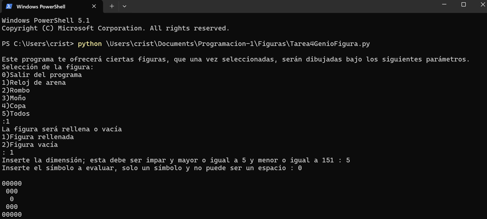

# Programacion 1

Este repositorio contiene los programas que desarrollé en programación 1, para poder preservarlos en caso de que mi computadora personal falle.

## Programas incluidos

| Programa | Función
|---|---|
|`NombreCalculadorIMCFinal.psc` |Programa que calcula tu índice de masa corporal.|
|`CalificacionNecesariaParaAlcanzarC 1(1).psc` |Programa que dadas las calificaciones de los alumnos da el promedio grupal.|
|`CurpCompletoFinal (2).psc` | Programa que con base en tus datos personales te da el curp.|
|`Tarea4GenioFigura.py`|Programa que te permite dibujar una selección de figuras en la terminal| 
|`Black_Jack_Definitivo(1).py`|Programa que te permite jugar al blackjack.|
|`gato(prototipo).py`|Programa que te permite jugar al gato.|

## Requisitos
Tener PSeINT descargado con la configuración UNISON-LCC.
Tener el intérprete de python descargado
Para poder jugar blackjack descargar el módulo customtkinter
.

## Como ejecutarlos 
Para los programas con terminación psc: Entrar en PSeINT, abrirlos usando el explorador de archivos de pseint y usando el botón de correr(flechita verde) ejecutarlos.
Para los programas con terminación py: Abrir la terminal de tu computadora y escribir el siguiente comando [python Raíz/NombreArchivo].

## Ejemplo de funcionamiento 

### Tarea4GenioFigura.py
Programa que dibuja figuras.

**Requisitos**
- Tener instalado el intérprete de python

**Ubicación**

`Programacion-1\Figuras\Tarea4GenioFigura.py`

**Ejemplo**

C:\Users\user> python  Raiz/Tarea4GenioFigura.py

Este programa te ofrecerá ciertas figuras, que una vez seleccionadas, serán dibujadas bajo los siguientes parámetros.  

Selección de la figura:  
0)Salir del programa  
1)Reloj de arena  
2)Rombo  
3)Moño  
4)Copa  
5)Todos  
:1  

La figura será rellena o vacía  
1)Figura rellenada  
2)Figura vacía  
: 1  

Inserte la dimensión; esta debe ser impar y mayor o igual a 5 y menor o igual a 151 : 5  

Inserte el símbolo a evaluar, solo un símbolo y no puede ser un espacio : 0

     00000  
      000  
       0  
      000  
     00000  

## Autores
Cristobal Ochoa Isibasi   
Christian Alexandro Lopez 

